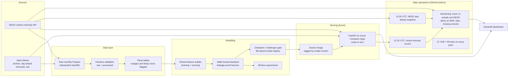

# GB Carbon Intensity Forecast: a production MLOps system

[](https://github.com/vijendrapokharkar15-design/gb-carbon-forecast-mlops/actions/workflows/ci.yml)

[](https://gb-carbon-forecast.streamlit.app/)
[](https://carbon-forecast-api.delightfulfield-1ac7d123.uksouth.azurecontainerapps.io/docs)

Day-ahead forecasting of Great Britain's electricity carbon intensity, issued every day at 12:00 UTC, telling flexible electricity users (EV fleets, batch computing, batteries) **when to run to emit the least CO₂**. Built and operated end to end: validated data pipelines, leakage-proof evaluation, champion/challenger retraining, a containerised API on Azure, and live monitoring against both reality and the national grid operator's own forecast.

**Live dashboard:** https://gb-carbon-forecast.streamlit.app/
**Live API:** https://carbon-forecast-api.delightfulfield-1ac7d123.uksouth.azurecontainerapps.io/docs

## Results at a glance

| Test year (Oct 2025 to Sep 2026), walk-forward | MAE (gCO₂/kWh) | Carbon regret | Good-window rate |
|---|---|---|---|
| **LightGBM, day-ahead weather forecasts (honest)** | **19.5** | **4.5** | **86.3%** |
| LightGBM, observed weather (optimistic ceiling) | 17.9 | 3.5 | 89.0% |
| Seasonal profile, last 4 weeks (baseline) | 42.1 | 12.3 | 68.7% |
| Naive, same time yesterday (baseline) | 40.3 | 21.4 | 52.5% |
| *NESO stored forecast (near-real-time, reference only)* | *9.9* | *1.7* | *96.4%* |

- **52% lower MAE than the best baseline, 63% lower carbon regret**, clearing both success targets fixed *before* training (MAE ≤ 30.2, regret ≤ 9.2)
- **Live performance matches the backtest:** the first on-time live day scored MAE 20.5 against a backtest promise of 19.5
- **Carbon regret** = how much dirtier the recommended 4-hour window was than the truly greenest one. It is the metric users actually feel, and it can disagree with MAE (see findings)

## Architecture



## What makes it trustworthy

**No leakage, enforced rather than hoped for**
- The backtest harness hands each forecaster only data published before the 12:00 issue time (a 30-minute publication lag is modelled), so no model can see the future however its features are written
- A **poisoned-future test** sets every actual after the cutoff to an absurd value and asserts that no feature changes
- **One feature builder** serves both training and live prediction, so training/serving skew is impossible by construction

**Honest evaluation**
- Walk-forward over a full year with monthly refits, covering every season; all choices made on a separate tuning year, and the test year run once
- The backtest was rerun with **archived day-ahead weather forecasts** (Open-Meteo Previous Runs API) instead of observed weather: the realistic 19.5 MAE, not the optimistic 17.9, is the headline
- **Daily NESO snapshots** build a fair day-ahead benchmark, because NESO's public history is revised close to real time (proven below)

**Fails loudly**
- Pandera schemas on raw and processed data; the API returns HTTP 503 with a reason instead of a forecast built on bad inputs
- A retrained model is promoted only if it beats the naive baseline and does not regress against the champion
- Monitoring turns the daily workflow red (triggering an email) if rolling 7-day MAE exceeds 30.2, bias exceeds ±10, or a daily record is missing
- Every snapshot and record is time-stamped; late ones are kept but excluded from fair comparisons

## Key findings

1. **NESO's historical forecasts are not day-ahead.** The stored forecast scores MAE 9.9, implausibly good. Comparing a captured 12:02 snapshot with the stored values for the same 48 half-hours showed 47 revised, by 20.5 gCO₂/kWh on average; that day's true day-ahead MAE was 20.5 versus 8.6 stored. Hence the daily snapshot job.
2. **MAE and regret can disagree.** The naive baseline had the better MAE (40.3 vs 42.1) but the seasonal profile had far lower regret (12.3 vs 21.4): it ranks the hours better. Judged on MAE alone, users would get worse charging windows on almost half of days.
3. **A training window must cover a full seasonal cycle.** Training on 2024 onwards looked worse on the tuning year, but almost all of the gap came from December 2024, the first December that model had never seen. From January the two were tied, so the all-history model was kept.
4. **Weather is the main driver; location matters.** An offshore wind index (North Sea, East Anglia, Irish Sea; Spearman -0.61) beat every single point. Day-ahead weather forecast error costs about 1.6 gCO₂/kWh of MAE, concentrated 6 to 18 hours ahead.
5. **A live forecast must be frozen at issue time.** The same "12:00" forecast computed hours later used newer weather runs and gave different numbers, an unfair advantage. The daily recorder freezes it at 12:10 UTC.

## Running it

```bash
python -m venv .venv && source .venv/bin/activate     # Windows: .venv\Scripts\Activate.ps1
pip install -r requirements.txt && pip install -e .
pytest                                                 # 99 tests, all offline

python pipelines/backfill.py                           # NESO, observed weather, day-ahead weather forecasts
python pipelines/build_processed.py                    # validate + clean
python pipelines/build_features.py                     # feature table
python pipelines/run_backtest.py --model all           # baselines
python pipelines/run_experiment.py --objective l1 --period test --serve-weather forecast
python pipelines/train_and_promote.py                  # champion / challenger

uvicorn carbon_forecast.serving.app:create_app --factory --port 8000
streamlit run dashboard/app.py
```

More detail: [problem statement and success criteria](docs/problem_statement.md) · [deployment and operations](docs/deployment.md) · [results table](docs/results.csv) · [live scores](monitoring/daily_scores.csv)

## Repository layout

```
configs/data.yaml          all settings in one place (tested for completeness)
src/carbon_forecast/
  ingestion/               NESO and Open-Meteo clients, retries, monthly Parquet storage
  validation/              Pandera schemas (raw and processed)
  processing/              cleaning: complete grids, invalid targets flagged
  features/                shared feature builder (training and serving)
  evaluation/              walk-forward harness, MAE and carbon regret
  training/                baselines, LightGBM, promotion rule, model registry
  serving/                 live data, forecast service, FastAPI app, forecast recorder
  monitoring/              live scoring, NESO head-to-head, alerts
pipelines/                 runnable entry points (backfill, train, record, monitor...)
dashboard/                 Streamlit app
notebooks/                 API exploration, data quality, EDA, model comparison, weather forecasts
benchmark/ forecasts/ monitoring/   daily snapshots, frozen forecasts, live scores (committed by the bots)
.github/workflows/         CI, daily snapshot, daily forecast + monitoring
```

## Limitations and future work

- **The NESO head-to-head is only starting.** Fair comparisons began on 21 October 2026 and accumulate daily; a single day of evidence (MAE 20.5 for NESO day-ahead) is not a benchmark
- **CI does not build the Docker image**, because the champion model lives outside Git. Next step: store models in a registry (Azure Blob or MLflow) so CI can build, push and deploy automatically
- **Promotion uses a 28-day window**, where regret is noisy; a longer window or a noise-aware tolerance would reduce chance rejections
- **The model trains on observed weather but serves on forecasts;** training on archived forecasts (available from March 2024) may correct the forecasts' wind bias
- **Deliberate scope cuts for a 4-day build:** GitHub Actions and cron-job.org instead of Prefect, deterministic rebuilds instead of DVC, a file registry instead of an MLflow server

## Data and credits

Carbon intensity from the [NESO Carbon Intensity API](https://carbonintensity.org.uk/). Weather data by [Open-Meteo.com](https://open-meteo.com/) (CC BY 4.0).